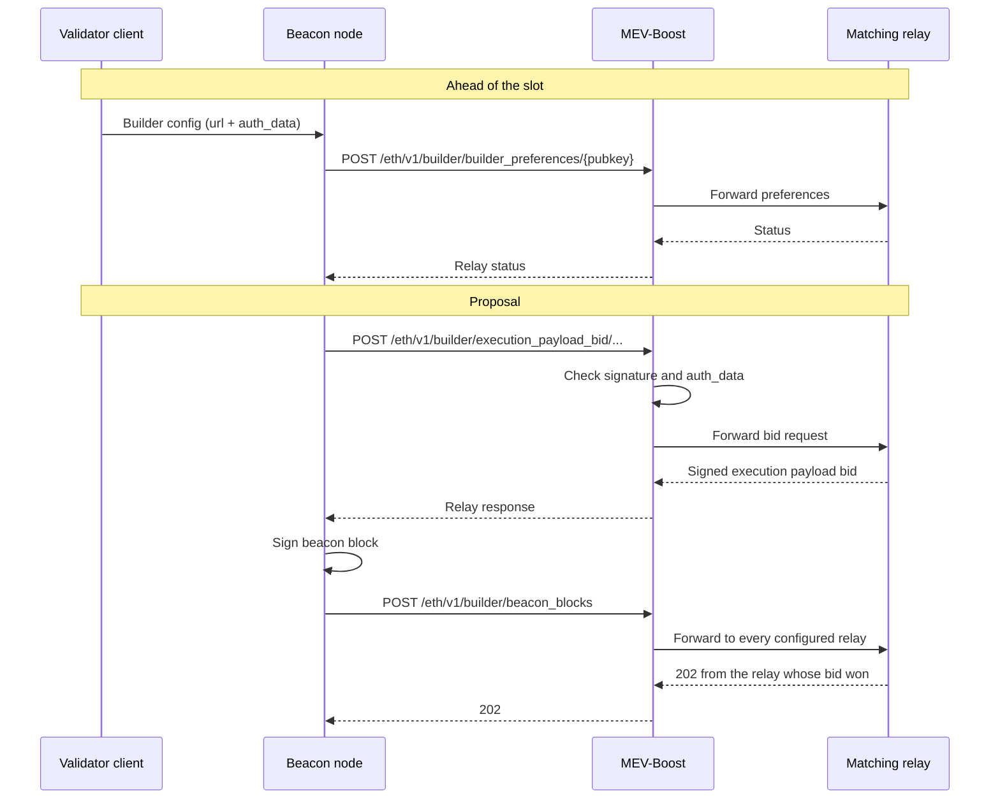

# ePBS (Gloas)

:::info
This page describes Gloas (ePBS) support in [flashbots/mev-boost#914](https://github.com/flashbots/mev-boost/pull/914). It is not in a released build yet. Until you run a build that includes it, MEV-Boost serves only the current builder API (`registerValidator`, `getHeader`, `submitBlindedBlock`).
:::

From the Gloas fork, a proposer commits to a builder's signed execution payload bid, and the winning builder publishes the payload. The beacon node stops calling `getHeader` / `submitBlindedBlock` for that proposal and calls three new builder-API endpoints instead. MEV-Boost serves both sets at the same time. The legacy endpoints are unchanged.

The bid fan-out moves to the beacon node. Today, one call to MEV-Boost asks every configured relay and MEV-Boost picks the best bid. After Gloas, the beacon node sends **one bid request per builder entry**, and each request names the relay it is for. MEV-Boost checks the proposer's signature and forwards that request, unchanged, to the one configured relay whose `auth_data` matches.

## Endpoints

| Endpoint | What the beacon node sends | What MEV-Boost does |
|----------|----------------------------|---------------------|
| `POST /eth/v1/builder/execution_payload_bid/{slot}/{parent_hash}/{parent_root}/{proposer_pubkey}` | A signed bid request for one relay | Forwards it to the matching relay and returns that relay's bid |
| `POST /eth/v1/builder/builder_preferences/{proposer_pubkey}` | The proposer's preferences, including `max_execution_payment`, for one relay | Forwards them to the matching relay and returns that relay's status |
| `POST /eth/v1/builder/beacon_blocks` | The signed beacon block that commits to the winning bid | Forwards it to **every** configured relay. Returns `202` when one relay accepts it |

`Eth-Consensus-Version: gloas` is required. Bodies are JSON (`application/json`) or SSZ (`application/octet-stream`).



### Bid requests

MEV-Boost accepts the request only when all of these hold:

- `Date-Milliseconds` and `X-Timeout-Ms` are present, and `X-Timeout-Ms` is greater than zero. The timeout is capped at one slot.
- The auth container's slot equals the slot in the path.
- `auth_data` equals exactly one relay in the proposer's relay set.
- The proposer public key in the path signed the auth container.

A request that names no configured relay gets **`400`**. MEV-Boost does not dial a relay that is absent from its config.

The relay's response is passed back as-is, including a `200` with the bid. If the proposer's deadline has already passed, or the relay does not answer (timeout, connection error, or an HTTP 5xx), MEV-Boost returns **`204`** and the beacon node can use another builder entry or its local block.

`-min-bid` is not applied on this path. The beacon node compares the bid with the `min_bid` and `builder_boost_factor` in the validator's builder config.

### Builder preferences

Preferences are routed the same way as a bid: one matching relay, signature checked. A preference for a slot that has already passed is rejected with `400`. The register-validator timeout (`-request-timeout-regval`, default 3000 ms) bounds the forward. If the relay does not answer, MEV-Boost returns **`500`**.

### Signed beacon block

MEV-Boost does not remember which relay won the bid, so the signed block is sent to every relay in the default set and every [mux](./relay-muxing) group. The handler returns **`202`** as soon as one relay accepts the block. If none accept it, the response is **`500`**. Each forward uses the get-payload timeout (`-request-timeout-getpayload`, default 4000 ms).

## Auth data

`auth_data` is the byte string that tells MEV-Boost which relay a request is for. It is compared as raw bytes with the relay entry, not as a URL.

The default is the relay hostname: lowercase, no scheme, no port, no path, and no public key. That is the [builder-specs default](https://github.com/ethereum/builder-specs/blob/main/specs/gloas/validator.md#default-auth-data). An IPv6 address is compressed and wrapped in brackets.

| Relay URL | Default `auth_data` |
|-----------|---------------------|
| `https://0xabc...@boost-relay.flashbots.net` | `boost-relay.flashbots.net` |
| `https://0xabc...@relay.example.com:8080` | `relay.example.com` |

A value agreed with a relay is set on that relay in the YAML config, as a plain string or `0x`-prefixed hex. CLI-only relays (`-relay` / `-relays`) always use the hostname default. Two relays in the same relay set must have different `auth_data`; MEV-Boost refuses to start, or to apply a reloaded config, when they collide. A default set and a mux group are checked separately, so the same hostname may appear in two groups.

```yaml
relays:
  - url: https://0xPUBKEY@boost-relay.flashbots.net
    # Omit auth_data to use the hostname.
    # auth_data: "boost-relay.flashbots.net"
    # auth_data: "0x626f6f73742d72656c61792e666c617368626f74732e6e6574"
```

Hot reload (`-watch-config`) picks up `auth_data` changes with the rest of the file.

## Point the validator client at MEV-Boost

The validator client holds each key's builder list. For every relay MEV-Boost should reach, add one entry:

- `url` — MEV-Boost's address, as the beacon node reaches it (`http://127.0.0.1:18550` when they share a host).
- `auth_data` — the `0x`-prefixed hex of that relay's `auth_data` (the hostname, unless you overrode it).

To encode a hostname:

```bash
printf '0x%s\n' "$(printf '%s' boost-relay.flashbots.net | od -An -tx1 | tr -d ' \n')"
```

That prints `0x626f6f73742d72656c61792e666c617368626f74732e6e6574`.

Set `auth_data` on every entry whose URL is MEV-Boost. If it is omitted, the validator client derives it from MEV-Boost's own hostname, MEV-Boost finds no relay with that value, and the bid request is rejected with `400`.

A key can list MEV-Boost and a relay directly. Give both entries the same `min_bid`, `builder_boost_factor`, and `max_execution_payment`, so the beacon node scores a bid the same way on either route. A single key is limited to 64 builder entries.

Clients are still changing how this file is written. Check the client guide before copying a config across versions. The [consensus client table](./usage#consensus-client-compatibility) links to each client's builder docs. The shape below is Lighthouse's `builder_definitions.yml`; Lodestar and Prysm use their proposer-settings files, and the keymanager API (`POST /eth/v1/validator/{pubkey}/builder_config`) accepts the same `url` and `auth_data` fields.

```yaml
builders:
  - enabled: true
    url: "http://127.0.0.1:18550"
    auth_data: "0x626f6f73742d72656c61792e666c617368626f74732e6e6574" # boost-relay.flashbots.net
    max_execution_payment: 18446744073709551615
  - enabled: true
    url: "http://127.0.0.1:18550"
    auth_data: "0x72656c61792d686f6f64692e756c747261736f756e642e6d6f6e6579" # relay-hoodi.ultrasound.money
    max_execution_payment: 18446744073709551615
```

`builder_pubkeys`, when a client asks for it, filters which builders' bids the beacon node will accept. Leave it empty to accept any. The public key in a relay URL is the relay's key, not a builder's bid-signing key.

### Relay multiplexing

Bid and preference requests are matched only against the proposer's relay set: the mux group the pubkey belongs to, or the top-level `relays` list when it belongs to none. A pubkey outside a group cannot reach a relay that exists only inside that group. The signed block is still sent to every configured relay. See [Relay Multiplexing](./relay-muxing).

## Timing

The bid request's `Date-Milliseconds` and `X-Timeout-Ms` are the beacon node's deadline. MEV-Boost shortens that deadline in three ways:

1. If the beacon node's clock is ahead, the deadline is brought back to `X-Timeout-Ms` from MEV-Boost's own clock.
2. It is capped at the slot start plus `late_in_slot_time_ms` (default 2000). A mux group uses its own `late_in_slot_time_ms` when the proposer is in that group.
3. A fixed **50 ms** margin is reserved so the response can still reach the beacon node. This margin is not configurable.

The `X-Timeout-Ms` MEV-Boost sends on to the relay is the time remaining after that, and also no longer than the get-header HTTP client timeout (`-request-timeout-getheader`, default 950 ms) minus the same 50 ms. The YAML `timeout_get_header_ms` value, including a mux override, is not what bounds this call.

If timing games are enabled on the matching relay, MEV-Boost waits until `target_first_request_ms` into the slot and then polls every `frequency_get_header_ms` until the deadline above. It returns the latest `200`, or the most recent non-`200` if the relay never returned a bid. Those settings apply to ePBS bids as well as to `getHeader`. See [Timing Games](./timing-games).

## Checking a proposal

At info level, a successful bid logs `bid received` with `blockHash`, `builderIndex`, `valueGwei`, and `executionPaymentGwei`, and the relay URL. `no bid from relay` means the relay answered with something other than `200`. `forwarded builder preferences` logs the slot and `maxExecutionPayment`. `signed beacon block accepted by relay` means one relay returned `202`.

With `-metrics`, the same events increment `mev_boost_beacon_node_status_code_total`. The `endpoint` label is the route template, for example the execution-payload-bid path. A `200` is a bid returned to the beacon node, a `204` is no bid, and a `202` is an accepted signed block. See [Metrics & Monitoring](./metrics).
