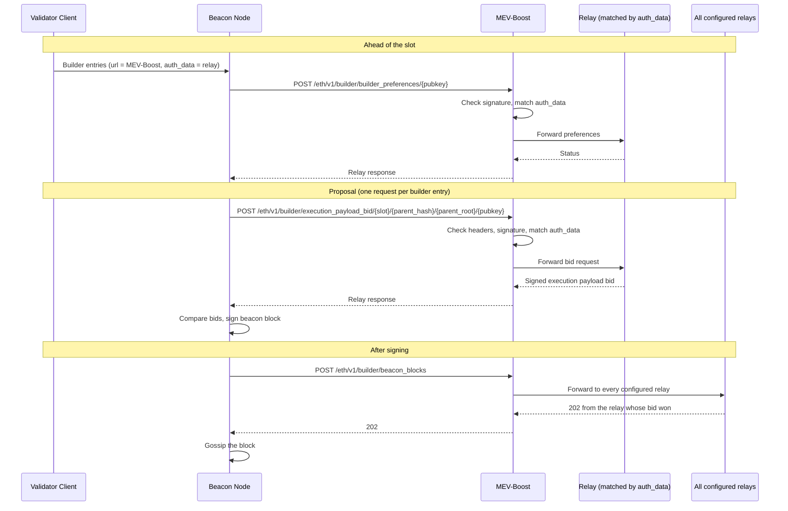

# Gloas (ePBS)

:::info
Gloas support is added in [flashbots/mev-boost#914](https://github.com/flashbots/mev-boost/pull/914) and is not in a release yet. Until you run a build that includes it, MEV-Boost serves only the pre-Gloas builder API.
:::

The Gloas fork enshrines proposer-builder separation (ePBS) in the protocol. A proposer no longer asks for a blinded header and then the full payload. It commits to a builder's **signed execution payload bid** in its beacon block, and the builder whose bid won reveals the payload afterwards.

From Gloas, the beacon node stops calling `getHeader`, `submitBlindedBlock` and `registerValidator` and calls three new builder API endpoints instead. MEV-Boost serves both sets side by side. The pre-Gloas endpoints are unchanged.

## What Changes for MEV-Boost

| | Before Gloas | From Gloas |
|---|---|---|
| Who asks the relays | MEV-Boost asks every relay in one `getHeader` call | The beacon node sends **one bid request per relay**, and each request names the relay it is for |
| Who picks the best bid | MEV-Boost | The beacon node |
| How MEV-Boost picks a relay | It calls all of them | It matches the request's `auth_data` to exactly one configured relay |
| Minimum bid | `-min-bid` in MEV-Boost | `min_bid` and `builder_boost_factor` in the validator client's builder config |
| After the block is signed | MEV-Boost fetches the payload from the winning relay | MEV-Boost passes the signed block to the relays, and the winning builder reveals the payload |

MEV-Boost forwards each request unchanged. It checks the proposer's signature and the request's timing, then returns the relay's response as it is.



## Setup

You need two things: MEV-Boost configured with your relays, as before, and a builder entry in the validator client for each relay MEV-Boost should reach.

### 1. Configure MEV-Boost

Relays are configured as they are today, with `-relay`, `-relays`, or the YAML `-config` file. Nothing else is required. Each relay gets a default `auth_data` (its hostname, see [Auth Data](#auth-data)), and that is the value the validator client must send.

Use the YAML config only if a relay has asked you to send a different `auth_data`:

```yaml
relays:
  - url: https://0xPUBKEY@boost-relay.flashbots.net
    # Omit auth_data to use the hostname, "boost-relay.flashbots.net".
  - url: https://0xPUBKEY@relay.example.com
    # A value agreed with this relay, as a string or 0x-prefixed hex.
    auth_data: "my-agreed-value"
```

### 2. Add Builder Entries to the Validator Client

From Gloas, the validator client holds a list of builders for each validator key. Each builder entry has a `url` and an `auth_data`. To send bid requests through MEV-Boost, add **one entry per relay**:

- **`url`**: MEV-Boost's address, as the beacon node reaches it, for example `http://127.0.0.1:18550`.
- **`auth_data`**: the `0x`-prefixed hex of that relay's `auth_data` in MEV-Boost. Unless you set one in the YAML config, that is the relay hostname.

To encode a hostname as hex:

```bash
printf '0x%s\n' "$(printf '%s' boost-relay.flashbots.net | od -An -tx1 | tr -d ' \n')"
# 0x626f6f73742d72656c61792e666c617368626f74732e6e6574
```

:::warning
Always set `auth_data` on entries that point at MEV-Boost. If it is left out, the validator client derives it from the entry's own URL, which is MEV-Boost's address (for example `127.0.0.1`). No relay in MEV-Boost has that `auth_data`, so every bid request is rejected with `400`.
:::

How the list is written depends on the client and version, so check your client's builder documentation. The [consensus client table](./usage#consensus-client-compatibility) links to each guide. For example, Prysm v7.3.0 takes `auth_data` as a URL fragment on `--builder-urls`:

```bash
--builder-urls=http://127.0.0.1:18550#0x626f6f73742d72656c61792e666c617368626f74732e6e6574
```

The `min_bid` and `builder_boost_factor` on a builder entry are applied by the beacon node when it compares bids. MEV-Boost's `-min-bid` is not applied to Gloas bids.

## Auth Data

`auth_data` is a byte string, up to 4096 bytes, that the validator client signs into each bid and preferences request. It tells MEV-Boost which relay the request is for. MEV-Boost compares it byte for byte with each relay's `auth_data`. It is not parsed as a URL.

### Default Value

By default a relay's `auth_data` is its hostname, following the [builder-specs default](https://github.com/ethereum/builder-specs/blob/main/specs/gloas/validator.md): lowercase, without the scheme, port, path, or the relay public key. An IPv6 address is written in its compressed form inside brackets.

| Relay URL | Default `auth_data` |
|-----------|---------------------|
| `https://0xPUBKEY@boost-relay.flashbots.net` | `boost-relay.flashbots.net` |
| `https://0xPUBKEY@Relay.Example.com:8080/path` | `relay.example.com` |
| `http://0xPUBKEY@10.0.0.5:18550` | `10.0.0.5` |
| `http://0xPUBKEY@[0:0:0:0:0:0:0:1]:8443` | `[::1]` |

### Overriding It

Set `auth_data` on a relay in the YAML config, as a plain string or as `0x`-prefixed hex. It can be set on top-level relays and on relays inside a [mux group](./relay-muxing). Relays passed with `-relay` or `-relays` always use the hostname default.

### Uniqueness

Every relay in a relay set must have a different `auth_data`, otherwise MEV-Boost could not tell which one a request is for. The top-level `relays` list and each mux group are checked separately. If two relays in one set share an `auth_data`, MEV-Boost refuses to start. When the config is hot reloaded, the new config is rejected and the old one is kept.

This most often happens with two relays on the same host on different ports, for example two services on `127.0.0.1`. Give each one a distinct `auth_data` in the YAML config, and use those values in the validator client.

## Endpoints

All three endpoints require the `Eth-Consensus-Version: gloas` header. Request bodies are JSON (`application/json`, also the default when `Content-Type` is missing) or SSZ (`application/octet-stream`), and are limited to 10 MiB.

### Execution Payload Bid

`POST /eth/v1/builder/execution_payload_bid/{slot}/{parent_hash}/{parent_root}/{proposer_pubkey}`

The body is the proposer's `SignedBuilderRequestAuth`. MEV-Boost accepts the request only when:

- `Date-Milliseconds` and `X-Timeout-Ms` are present, and `X-Timeout-Ms` is greater than zero.
- The slot in the signed auth equals the slot in the path.
- The `auth_data` matches a relay in the proposer's relay set.
- The signature verifies against the proposer public key in the path.

It then forwards the body unchanged to that relay and returns the relay's response.

| Situation | Response |
|-----------|----------|
| The relay returns a bid | `200` with the relay's bid |
| The relay returns `204` or a `4xx` | Passed through as is |
| The relay returns a `5xx`, times out, or can't be reached | `204` |
| The proposer's deadline has already passed | `204`, the relay is not called |
| Missing or invalid headers, path, or body; unknown `auth_data`; slot mismatch | `400` |
| Unsupported `Content-Type` | `415` |
| Invalid signature | `401` |

A `204` means there is no bid from this relay. The beacon node can still use bids from its other builder entries, or build the block locally.

### Builder Preferences

`POST /eth/v1/builder/builder_preferences/{proposer_pubkey}`

The body carries the proposer's preferences (`max_execution_payment`, the most the proposer will accept as an execution payment) together with a signed auth. It is routed like a bid request: the `auth_data` must match one relay, and the signature must verify. Preferences for a slot that has already passed are rejected with `400`.

The relay's response is passed back. If the relay times out, can't be reached, or returns a `5xx`, MEV-Boost returns `500`. The forward is bounded by `-request-timeout-regval` (default 3000 ms).

### Signed Beacon Block

`POST /eth/v1/builder/beacon_blocks`

The body is the signed beacon block that commits to the winning bid. MEV-Boost does not keep track of which relay's bid won, so it forwards the block to **every configured relay**: the top-level list and all mux groups. Only the relay whose bid won accepts it.

MEV-Boost returns `202` as soon as one relay accepts the block, and `500` if none does. Each forward is bounded by `-request-timeout-getpayload` (default 4000 ms). The beacon node gossips the block itself whatever the response.

## Deadlines and Timing Games

The beacon node sets the deadline for a bid request with `Date-Milliseconds` and `X-Timeout-Ms`. MEV-Boost computes its own deadline as the earliest of:

1. `Date-Milliseconds` + `X-Timeout-Ms`.
2. Now + `X-Timeout-Ms`, in case the beacon node's clock runs ahead of MEV-Boost's.
3. Slot start + `late_in_slot_time_ms` (default 2000 ms, or the mux group's override).

`X-Timeout-Ms` is capped at one slot. MEV-Boost then subtracts a fixed **50 ms** margin so the response still reaches the beacon node in time. The `X-Timeout-Ms` sent on to the relay is the time left until that deadline, and never more than `-request-timeout-getheader` (default 950 ms) minus 50 ms. `timeout_get_header_ms` from the YAML config is not used for Gloas bids.

### Timing Games

[Timing games](./timing-games) work on Gloas bid requests with the same per-relay settings. When `enable_timing_games` is set on the matched relay:

1. MEV-Boost waits until `target_first_request_ms` into the slot. If that time has already passed, it sends the first request right away.
2. With `frequency_get_header_ms` set, it sends a new request at that interval. No new request starts within one interval of the deadline.
3. At the deadline it returns the bid from the **most recently sent** request that returned one. If the relay never returned a bid, it returns the relay's last other response.

For example, with a 100 ms frequency and a beacon node that sends the request just after the target time with about 545 ms left, MEV-Boost sends 5 requests, at 0, 100, 200, 300 and 400 ms.

## Relay Multiplexing

[Mux groups](./relay-muxing) decide which relays a bid or preferences request can reach. MEV-Boost looks up the proposer's relay set (its mux group, or the top-level `relays` list if it is in none) and only matches `auth_data` against relays in that set. A validator outside a group can't reach a relay that is only listed inside that group.

The signed beacon block is still sent to every configured relay, in every group.

## Logs and Metrics

At the `info` log level:

| Log message | Meaning |
|-------------|---------|
| `bid received` | The relay returned a bid. Includes `blockHash`, `builderIndex`, `valueGwei` and `executionPaymentGwei`. |
| `no bid from relay` | The relay answered with something other than `200`. |
| `forwarded builder preferences` | Preferences were forwarded. Includes the slot, `maxExecutionPayment` and the relay's status code. |
| `signed beacon block accepted by relay` | A relay returned `202` for the signed block. |
| `rejecting request` (warning) | MEV-Boost rejected the request. The error says why, for example an `auth_data` that matches no relay. |

With `-debug`, MEV-Boost also logs the computed `bid deadline` (`timeoutMs`) for each bid request.

With `-metrics`, Gloas requests are counted in the same metrics as the pre-Gloas endpoints. The `endpoint` label is the Gloas route.

| Metric | What it shows for Gloas |
|--------|-------------------------|
| `mev_boost_beacon_node_status_code_total{http_status_code, endpoint}` | Responses to the beacon node: `200` is a bid returned, `204` no bid, `202` an accepted block. |
| `mev_boost_relay_status_code_total{http_status_code, endpoint, relay}` | Status codes returned by each relay. |
| `mev_boost_relay_latency{endpoint, relay}` | Latency of each forward to a relay, in milliseconds. |
| `mev_boost_bid_values{relay}` | Bid value plus execution payment, in ETH. |
| `mev_boost_relay_last_slot{relay}` | The last slot each relay returned a bid for. |

## Specifications

- [Builder specs, Gloas](https://github.com/ethereum/builder-specs/tree/main/specs/gloas) — the bid, preferences and beacon block endpoints, and the default `auth_data`.
- [Consensus specs, Gloas](https://github.com/ethereum/consensus-specs/tree/master/specs/gloas) — the protocol changes behind ePBS.
- [flashbots/mev-boost#914](https://github.com/flashbots/mev-boost/pull/914) — the MEV-Boost implementation.
